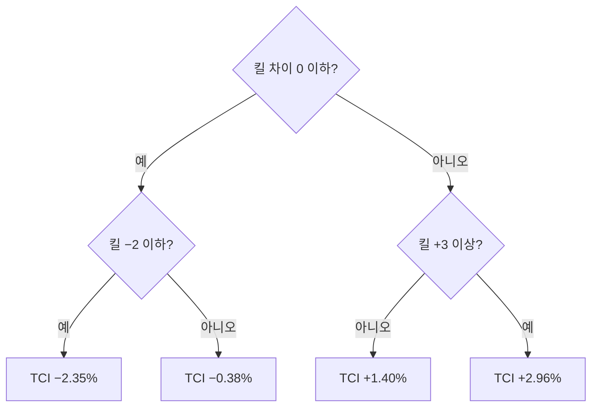

# 롤 4대 라인별 라인전 기여도 측정 모델 (TCI)

> **"이겼다고 잘한 것이 아니고, 졌다고 못한 것이 아니다."**

본 프로젝트는 2025 시즌 KR 챌린저 솔로랭크 15,276경기의 1분 단위 기록을 이용하여, 라인별로 "매 분 맞라이너보다 골드를 얼마나 더 확보하고 있었는가"를 하나의 지표(TCI)로 정의하고, 이 지표를 CS·킬·데스·포탑 방패·와드 같은 플레이 기록만으로 예측할 수 있는지 검증한 프로젝트이다.

---

## 1. 서론

### 1.1 문제 정의

챌린저 티어의 솔로랭크는 일반적인 랭크 게임과 성격이 다르다. 이 구간의 플레이어들은 이미 게임의 기본기를 갖춘 최상위 사용자이며, 상당수는 프로 선수, 연습생, 스트리머이다. 이들에게 솔로랭크는 단순히 점수를 올리는 곳이 아니라 **개인의 기량을 갈고 닦는 훈련장**이다. 승패도 중요하지만, 새로운 챔피언을 실전에서 숙달하고, 패치로 바뀐 메타에 적응하며, 프로 리그전을 준비하는 연습 무대로 쓰인다.

이러한 목적에서 가장 중요한 구간은 **라인전**이다. 라인전은 게임 초반 각 라인에서 맞라이너와 1:1(바텀은 2:2)로 CS와 킬을 다투는 구간으로, 팀원의 영향이 가장 적고 개인의 실력이 가장 직접적으로 드러나는 시간이다. 새 챔피언을 연습하는 사람은 "이 챔피언으로 라인전을 이길 수 있는가"를, 프로 지망생은 "같은 티어의 상대와 라인전에서 얼마나 앞서는가"를 알고 싶어 한다.

그러나 현재 전적 사이트가 보여 주는 정보는 승률, KDA, 게임 종료 시점의 골드처럼 **경기의 결과**뿐이다. 5명이 함께 하는 게임에서 승패는 개인의 기량을 정확히 반영하지 못한다. 탑에서 솔로킬을 두 번 따고 CS를 40개 앞서도 바텀이 무너지면 패배하고, 미드가 0/5/2로 밀려도 정글과 원딜이 캐리하면 승리한다. 즉 승패만으로는 "내가 라인전을 잘했는가"라는 질문에 답할 수 없다.

라이엇 API는 게임 진행 중 1분마다 10명 전원의 골드, CS, 딜량을 기록하고(타임라인), 킬·포탑 방패·드래곤·와드 같은 사건도 발생 시각과 함께 저장한다. 본 프로젝트는 이 기록을 이용하여 **승패와 분리된, 라인전 과정 자체를 평가하는 지표**를 만들고자 한다.

### 1.2 TCI의 정의

본 프로젝트에서 사용하는 핵심 지표는 **TCI(Timeline Contribution Index, 타임라인 기여도 지수)** 이다. TCI는 경기의 매 분마다 "한 라인이 맞라이너에 비해 골드를 얼마나 더 확보하고 있는가"를 나타내며, 다음과 같이 계산한다.

$$
\text{TCI} = \frac{\text{블루 라인 골드} - \text{레드 라인 골드}}{\text{게임 전체(10명) 골드}}
$$

TCI가 양수이면 블루 쪽 라이너가, 음수이면 레드 쪽 라이너가 앞서고 있다는 뜻이다. 예를 들어 TCI가 +0.03이면 "게임에 풀린 전체 골드의 3%만큼 블루 라이너가 앞서 있다"는 의미이다. 분모를 전체 골드로 둔 이유는 시점에 따라 같은 골드 차이의 무게가 다르기 때문이다. 10분에는 10명의 골드 합계가 약 3.5만, 20분에는 약 7.6만이므로, 같은 1,000골드 차이라도 10분 쪽이 훨씬 큰 격차이다. 전체 골드로 나누면 어느 시점이든 같은 기준으로 비교할 수 있다.

### 1.3 라인별 특성

라인마다 "잘한다"의 기준은 다르다. 탑은 갱킹이 적은 외딴 라인이므로 CS 관리와 1:1 솔로킬이 핵심이라고 보았다. 미드는 맵 중앙에 위치하여 라인전과 함께 다른 라인을 돕는 로밍이 중요하다. 정글은 고정된 라인이 없으므로 갱킹의 성공, 정글 캠프 관리, 드래곤·유충 같은 오브젝트 확보가 역할의 중심이다. 바텀은 원딜과 서포터가 함께 싸우는 2:2 라인으로, 킬각 싸움과 서포터의 시야 장악이 중요하다. 바텀은 두 사람이 같이 이기고 같이 지는 구조이므로, 본 프로젝트에서는 원딜과 서포터를 하나의 팀(듀오)으로 묶어 TCI를 계산하였다.

### 1.4 프로젝트 목표

본 프로젝트의 목표는 네 가지이다. 첫째, 라인전의 우열을 나타내는 정답 지표(TCI)를 정의하고 이 지표가 실제 승패와 같은 방향으로 움직이는지 확인한다. 둘째, 라인마다 그 라인의 역할에 맞는 플레이 기록(피처)을 설계한다. 셋째, 단순한 모델부터 인공신경망까지 여러 모델로 TCI를 예측하여 라인별 최종 모델을 선정한다. 넷째, 모델이 예측한 TCI와 실제 TCI를 비교하여 승패로는 보이지 않는 플레이를 설명하는 데 활용한다.

---

## 2. 데이터셋

분석 대상은 2025 시즌 KR 서버 챌린저 솔로랭크 **15,276경기**이다. 경기 시간은 20분에서 53분 사이이며, 블루팀 승률은 51.6%이다. 데이터는 Riot API의 두 가지 파일로 구성된다. `match_N.json`은 게임이 끝난 뒤의 결과창으로, 승패와 10명의 포지션·챔피언·최종 KDA를 담고 있다. `timeline_N.json`은 1분마다 찍힌 기록으로, 매 분 10명의 골드·CS·정글몹 처치·딜량·받은 피해·CC 시간과, 그 1분 동안 일어난 킬·포탑 방패·오브젝트·와드 설치 및 제거 사건을 담고 있다. 두 파일은 참가자 번호(1\~10)로 연결된다.

원본 JSON은 수십 GB 규모이므로 `extract_all.py`로 필요한 값만 뽑아 약 170MB의 CSV 3개로 줄인 뒤 분석하였다. 이 과정에서 공정한 비교가 불가능한 경기는 제외하였다. 20분 이전에 끝난 경기는 서렌이나 탈주로 라인전 구간 자체가 없으므로 제외하였고, 저장 중 깨진 파일, match와 timeline의 짝이 맞지 않는 경기, 한 팀에 같은 포지션이 두 명이어서 라인끼리 비교할 수 없는 경기, 중복 저장된 경기도 제외하였다.

분석 구간은 **5분에서 20분**으로 한정하였다. 5분 이전은 첫 웨이브 직후라 라인 간 골드 차이가 거의 없고, 20분 이후는 라인이 무너지고 한타와 오브젝트 중심으로 게임이 전개되어 더 이상 "라인전 실력"이라 보기 어렵기 때문이다. 또한 20분 이상 진행된 경기만 남겼으므로 모든 경기가 이 16분을 빠짐없이 가진다. 그 결과 라인마다 15,276경기 × 16분 = **244,416줄**, 4개 라인 합계 **977,664줄**의 학습 데이터가 만들어졌다.

---

## 3. 분석 방법

### 3.1 정답(타겟 변수) 설정

모델을 학습시키려면 먼저 맞혀야 할 정답이 필요하다. 이를 정하기 위해 골드, 경험치, 킬, 딜량, 받은 피해량 같은 후보 지표를 놓고 "게임이 끝났을 때 이 값이 더 큰 팀이 실제로 이겼는가"를 비교하였다.


그 결과 골드가 많은 팀이 **98.4%** 승리하여 가장 높은 일치율을 보였다. 경험치(97.1%)와 킬(94.0%)도 높았지만 골드를 넘지 못했으며, 받은 피해량이 많은 팀은 오히려 28.1%만 승리하였다. 이에 따라 정답의 재료로 골드를 선택하였다. 다만 게임 종료 시점의 골드는 결과 그 자체이므로, 과정을 보기 위해 **매 분의 골드 차이**를 사용하였다.

다음으로 경험치를 함께 섞으면 더 좋은 정답이 되는지 확인하였다. 골드와 경험치의 비율을 바꿔 가며 "TCI가 앞선 팀이 실제로 이겼는가"를 4개 라인 × 3개 시점(10·15·20분) × 15,276경기, 약 18만 건에 대해 계산하였다.


골드만 사용했을 때의 일치율은 61.0%, 가장 좋은 비율로 섞었을 때는 61.6%로 차이는 0.5%p에 불과하였다. 경험치만 사용하면 60.6%로 가장 낮았다. 경험치 역시 CS와 킬에서 나오므로 골드와 거의 같이 움직이기 때문이다. 섞어도 성능이 거의 오르지 않고 설명만 복잡해지므로 정답은 골드 하나로 정하였다.

이렇게 정한 TCI가 의미 있는 지표인지 확인하기 위해, 라인 하나의 TCI 부호만으로 경기 승패를 맞혀 보았다.


모든 라인, 모든 시점에서 동전 던지기 수준인 50%보다 높은 일치율을 보였다. 20분에 바텀이 앞선 팀은 68%, 정글이 앞선 팀은 67% 승리하였다. 또한 모든 라인에서 10분, 15분, 20분으로 갈수록 일치율이 올라갔는데, 이는 시간이 지날수록 라인의 우위가 승패로 굳어진다는 것을 보여 준다. 나머지 4명이 함께 뛰는 팀 게임에서 라인 하나만 보고도 60% 이상 승패를 맞힌다는 것은, 한 라인의 우위가 경기에 상당한 영향을 준다는 뜻이다.

TCI는 한 경기의 흐름을 보여 주는 데에도 쓸 수 있다. 아래는 그레이브즈(블루)와 리신(레드)의 정글 대결을 TCI로 그린 것이다.


리신이 3\~6분에 골드를 앞서다가 그레이브즈가 7\~11분에 킬 관여를 쌓아 크게 역전하였고, 12분 이후 격차가 점점 줄어 23\~28분에는 거의 동점이 되었다가, 29분부터 다시 벌어져 블루가 승리하였다. 결과창에는 "블루 승" 한 줄만 남지만, TCI로 보면 초반에 밀리다가 뒤집고, 따라잡혔다가 다시 벌린 경기였음을 알 수 있다.

마지막으로 라인별로 격차가 얼마나 벌어지는지 살펴보았다.


바텀의 격차가 항상 가장 컸는데, 두 명이 묶여 있어 킬 한 번에 두 사람이 모두 손해를 보기 때문이다. 정글은 5분에 격차가 급격히 커지는데, 첫 정글링과 첫 갱킹의 결과가 바로 골드로 나타나기 때문이다. 탑은 라인전이 길게 이어지는 외딴 라인이어서 15분까지 격차가 계속 벌어졌고, 미드는 완만하게 커졌다.

### 3.2 피처 설계

**피처(feature)** 란 모델이 정답을 맞힐 때 참고하는 단서, 즉 입력 변수이다. 수업 예제(`data_process_sample.py`)는 피처를 만드는 방식으로 누적(지금까지 쌓인 내 값), 격차(내 값 − 상대 값), 시점(최근 1분간 늘어난 양), 이벤트(특정 사건의 횟수)의 네 가지를 제시한다. 본 프로젝트는 이 중 **격차 방식**으로 모든 피처를 통일하였다.

격차를 선택한 이유는 세 가지이다. 첫째, 정답인 TCI 자체가 "블루 − 레드"의 차이이므로 피처도 차이로 맞추어야 일관성이 있다. 둘째, CS 120개가 잘한 것인지는 상대를 봐야 알 수 있다. 상대가 140개라면 진 것이다. 셋째, 해외의 승패 예측 연구들도 대부분 골드 차이, 경험치 차이, 킬 차이 같은 격차를 핵심 입력으로 사용한다 [1][2][3]. 솔로킬이나 포탑 방패 같은 이벤트도 "블루 횟수 − 레드 횟수"로 바꾸어 같은 방식으로 맞추었다. 다만 네 가지 방식을 각각 학습시켜 성능을 직접 비교하는 실험은 수행하지 않았으며, 이는 한계로 남긴다.

모든 라인에는 공통 피처 6개를 넣었다. CS 차이(`csDiff`), 챔피언에게 넣은 딜 차이(`dmgDealtDiff`), 받은 딜 차이(`dmgTakenDiff`), CC로 상대를 묶은 시간 차이(`ccDiff`), 킬 차이(`killDiff`), 데스 차이(`deathDiff`)이다. 여기에 현재 시점(`minute`)을 추가하였는데, 같은 킬 1개 차이라도 7분과 18분의 의미가 다르기 때문이다.

라인별로는 그 라인의 역할을 반영하는 전용 피처를 더하였다. 탑에는 1:1 무력 싸움을 보기 위한 솔로킬 차이(`soloKillDiff`)와, 14분 이전 라인 주도권의 보상인 포탑 방패 차이(`plateDiff`)를 넣었다. 미드에는 솔로킬과 포탑 방패에 더해, 상대 미드가 아닌 다른 챔피언을 잡는 데 관여한 횟수의 차이(`roamKADiff`)를 넣어 로밍을 반영하였다. 정글에는 정글몹 처치 차이(`jgCsDiff`), 갱킹으로 킬을 만들어 준 것을 보기 위한 어시스트 차이(`assistDiff`), 팀의 드래곤·유충·전령 확보 차이(`epicDiff`), 그리고 유효 갱킹 차이(`effGankDiff`)를 넣었다. 유효 갱킹은 정글러가 관여한 킬 이후 1분 안에 팀이 드래곤·유충·전령·포탑 중 하나를 확보한 경우로 정의하였다. 킬만 따고 끝나는 갱킹이 아니라 실제 이득으로 이어진 갱킹을 세기 위해서이다. 바텀에는 포탑 방패 차이, 서포터의 주된 기여 방식인 어시스트 차이, 그리고 시야 싸움을 보기 위한 와드 설치 차이(`wardPlacedDiff`)와 와드 제거 차이(`wardKillDiff`)를 넣었다.


각 피처와 TCI의 상관계수를 보면, 모든 라인에서 킬 차이는 0.77\~0.82로 강한 양의 관계를, 데스 차이는 −0.52\~−0.69로 강한 음의 관계를 보였다. CS 차이는 탑(0.74)에서 가장 강하고 정글(0.49)에서 가장 약했는데, 탑은 막타 싸움이, 정글은 교전 결과가 골드를 좌우한다는 신호로 해석된다. 라인 전용 피처도 효과가 있었다. 탑의 포탑 방패(0.66)와 솔로킬(0.65), 미드의 로밍(0.47), 정글의 유효 갱킹(0.44), 바텀의 어시스트(0.62)가 의미 있는 상관을 보였다. 반면 CC 시간, 와드, 드래곤은 0.3 미만으로 관계가 약했다. CC나 시야는 팀에는 도움이 되지만 본인의 골드로 바로 바뀌지는 않기 때문이다.

### 3.3 모델

모델은 피처를 보고 정답을 맞히는 계산 방식이다. 본 프로젝트는 단순한 것부터 복잡한 것까지 6개의 모델을 비교하였다. 이렇게 여러 모델을 비교한 이유는, 복잡한 모델이 정말 필요한지 확인하기 위해서이다. 단순한 모델로도 충분하다면 굳이 복잡한 모델을 쓸 이유가 없다. 이해를 돕기 위해 "15분에 탑이 CS 17개, 킬 1개를 앞서고 있을 때 TCI는 얼마인가"라는 하나의 문제를 각 모델이 어떻게 푸는지로 설명한다.

**Baseline(평균 찍기)** 은 피처를 전혀 보지 않고 항상 학습 데이터의 평균값만 답하는 모델이다. 위 문제에도 "평균이 0 근처이니 0%"라고 답한다. 실제로 쓰려는 모델이 아니라, 다른 모델이 이것보다 얼마나 나은지 보기 위한 기준선이다.

**선형회귀** 는 피처마다 점수(가중치)를 하나씩 정해 두고 그 점수를 더해서 답을 내는 모델이다. 시험의 배점표와 비슷하다. 탑 데이터로 실제 학습한 결과를 피처 4개로 단순화하면 다음과 같다.

| 피처 | 1만큼 앞서면 TCI 변화 |
|:---|:---:|
| CS 1개 | +0.044% |
| 킬 1개 | +0.52% |
| 데스 1개 | −0.14% |
| 포탑 방패 1개 | +0.21% |

위 문제에 적용하면 0.044 × 17 + 0.52 × 1 ≈ 1.3%가 된다. 이 표에서 킬 1개는 CS 약 12개의 가치를 가지며, TCI 1%는 15분 기준 약 550골드에 해당한다. 선형회귀의 장점은 "무엇이 얼마나 중요한지"를 숫자 하나로 바로 읽을 수 있다는 것이다. 한계는 항상 일정한 비율로만 늘어나는 **직선** 관계밖에 표현하지 못한다는 것이다. "킬이 3개 이상 벌어지면 격차가 급격히 커진다" 같은 관계는 잡아내지 못한다.

**Ridge** 는 선형회귀와 같은 점수표 방식이지만, 특정 피처 하나에 점수가 과도하게 몰리지 않도록 벌점을 주는 장치가 추가된 모델이다. 킬과 CS처럼 함께 움직이는 피처가 있으면 선형회귀는 한쪽에 점수를 몰아주고 다른 쪽을 음수로 만드는 식으로 불안정해질 수 있는데, Ridge는 이를 막아 점수를 고르게 나누도록 한다.

**RandomForest** 는 점수표 대신 질문을 이어 가며 답을 좁혀 가는 **질문 나무(결정 나무)** 를 사용한다. 예를 들어 "킬 차이가 0보다 큰가? → 예 → CS 차이가 10 이상인가? → 예 → 그렇다면 TCI는 1.4%"와 같은 방식이다. RandomForest는 이런 나무 100개를 데이터의 일부만 보여 주며 **각자 따로** 만든 뒤 그 답을 평균 낸다. 여러 사람에게 따로 물어보고 평균을 내는 것과 같아서, 나무 하나가 실수해도 전체 답은 안정적이다.

**LightGBM** 은 본 프로젝트의 최종 모델이다. RandomForest와 같이 질문 나무를 쓰지만, 나무를 **차례로** 하나씩 추가한다는 점이 다르다. 첫 번째 나무가 대략적인 답을 내면, 두 번째 나무는 첫 번째 나무가 틀린 만큼만 맞히도록 학습하고, 세 번째 나무는 그래도 남은 오차만 맞히도록 학습한다. 이를 500번 반복하여 500개 나무의 답을 조금씩 더한 것이 최종 예측이 된다. 앞 사람의 실수만 계속 고쳐 나가는 **오답노트** 와 같은 방식이다. 아래는 정글 데이터로 만든 첫 번째 나무의 실제 모습이다.



첫 나무의 질문이 모두 킬로만 이루어져 있다는 점에서, 정글에서는 킬이 골드를 가장 크게 좌우한다는 것을 알 수 있다. 질문 나무가 롤 데이터에 잘 맞는 이유는, 킬·데스·포탑 방패가 0, 1, 2처럼 딱 끊어지는 숫자이고 골드도 **계단** 처럼 움직이기 때문이다. 실제로 정글의 킬 차이별 평균 TCI는 다음과 같이 계단 모양으로 증가한다.

| 정글 킬 차이 | −3 이하 | −2 | −1 | 0 | +1 | +2 | +3 이상 |
|:---|:---:|:---:|:---:|:---:|:---:|:---:|:---:|
| 평균 TCI | −2.81% | −1.71% | −0.94% | +0.06% | +1.10% | +1.85% | +2.96% |

이러한 계단식 관계는 직선만 그릴 수 있는 점수표보다 질문 나무가 훨씬 잘 표현한다. 또한 데이터가 많을수록 나무가 더 세밀한 질문을 만들 수 있다. 초기에 30경기로 실험했을 때는 나무가 질문을 몇 개밖에 만들지 못해 설명력(R²)이 0.80에 그쳤지만, 15,276경기에서는 잎이 63개인 나무 500개를 충분히 키울 수 있어 0.92까지 올라갔다.

**MLP(인공신경망)** 는 사람이 규칙을 정해 주지 않고, 피처들을 여러 층에서 섞어 가며 스스로 패턴을 찾는 모델이다. 본 프로젝트에서는 피처를 64가지 방식으로 한 번, 32가지 방식으로 한 번 더 섞은 뒤 TCI를 예측하도록 구성하였다. 이를 통해 "CS도 앞서고 데스도 적으면 크게 이기는 중"과 같은 피처 간의 조합을 스스로 학습한다.

선형회귀, Ridge, 신경망에는 학습 전에 모든 피처를 **z-score(표준화)** 로 변환하였다. z-score는 (값 − 평균) ÷ 표준편차로, 각 값을 "평균에서 몇 칸 떨어져 있는가"로 바꾸는 방법이다. CS 차이는 수십 단위, 딜 차이는 수천 단위이므로 그대로 넣으면 숫자를 곱하고 더하는 모델은 숫자가 큰 딜만 중요하게 보게 된다. z-score로 바꾸면 모든 피처가 같은 눈금에 놓인다. 특히 신경망은 정답인 TCI가 ±0.02 정도로 매우 작아 정답까지 표준화하였으며, 이를 하지 않았을 때는 R²가 음수로 나와 평균 찍기보다도 못한 결과를 보였다. 반면 RandomForest와 LightGBM은 "킬 차이가 2 이상인가"처럼 값의 **순서** 만 보고 데이터를 나누므로, 단위를 바꾸어도 결과가 같아 표준화가 필요하지 않다.

### 3.4 손실함수와 평가 지표

모든 모델은 같은 손실함수로 학습하였다. 손실함수는 모델이 틀린 정도를 벌점으로 계산하는 식이며, 본 프로젝트는 (정답 − 예측)²의 평균인 **MSE(평균제곱오차)** 를 사용하였다. 제곱을 하기 때문에 크게 틀린 예측일수록 벌점이 커지며, 모델은 이 벌점을 줄이는 방향으로 학습한다.

결과는 세 가지 지표로 평가하였다. **RMSE** 는 MSE에 제곱근을 씌운 값으로, 예측이 평균적으로 정답에서 얼마나 빗나갔는지를 나타낸다. 확률이 아니라 거리이며, 낮을수록 좋다. **R²(설명력)** 는 정답의 오르내림 가운데 몇 %를 모델이 설명했는지를 나타내며, 1이면 완벽한 예측, 0이면 평균으로 찍는 것과 같은 수준이다. **부호 일치율** 은 "블루가 앞서는 중인가, 레드가 앞서는 중인가"를 맞힌 비율이다. 정답이 "얼마나 앞서는가"라는 숫자이므로, 맞고 틀림만 보는 정확도보다 얼마나 빗나갔는지를 보는 RMSE를 주 지표로 삼았다.

### 3.5 검증 방법

같은 경기의 15분과 16분 기록은 거의 같다. 데이터를 줄 단위로 무작위로 나누면 같은 경기의 15분은 학습에, 16분은 시험에 들어가게 되어, 기출문제가 그대로 나온 시험처럼 점수가 부풀려진다. 이를 막기 위해 **경기 단위 5등분 교차검증** 을 사용하였다. 15,276경기를 약 3,055경기씩 5묶음으로 나누고, 4묶음으로 학습한 뒤 처음 보는 나머지 1묶음으로 평가하는 과정을 묶음을 바꿔 가며 5번 반복하였다. 따라서 이후의 모든 점수는 모델이 한 번도 본 적 없는 경기에 대한 성적이다.

---

## 4. 결과

### 4.1 모델 비교


아래 표는 6개 모델의 라인별 RMSE이다. 값은 보기 쉽도록 1,000을 곱한 것이며, 낮을수록 정답에 가깝게 예측한 것이다.

| 모델 | 탑 | 미드 | 정글 | 바텀 |
|:---|:---:|:---:|:---:|:---:|
| Baseline (찍기) | 24.64 | 21.29 | 22.56 | 33.19 |
| 선형회귀 | 9.48 | 9.35 | 10.36 | 14.69 |
| Ridge | 9.48 | 9.35 | 10.36 | 14.69 |
| RandomForest | 6.67 | 6.93 | 6.69 | 9.60 |
| **LightGBM** | **6.36** | **6.61** | **6.40** | **9.10** |
| MLP (신경망) | 6.35 | 6.67 | 6.43 | 9.12 |

가장 단순한 선형회귀만으로도 평균 찍기보다 오차가 54\~62% 작았다. 이는 설계한 피처가 라인의 골드 우위를 설명하는 데 실제로 유효하다는 것을 의미한다. 질문 나무를 쓰는 RandomForest와 LightGBM, 그리고 신경망은 선형회귀보다 오차를 다시 29\~38% 줄였다. 이 차이는 롤의 골드가 직선이 아니라 계단과 조합의 형태로 움직이기 때문에 생긴다. 점수표 방식은 "킬 몇 개 이상이면 격차가 급격히 커진다"는 관계를 표현할 수 없지만, 질문 나무와 신경망은 이를 학습할 수 있다.

선형회귀와 Ridge의 결과는 소수점 둘째 자리까지 같았다. Ridge의 장치는 데이터가 적어 점수가 한쪽 피처로 쏠릴 위험이 있을 때 효과를 내는데, 라인당 24만 줄의 데이터에서는 그런 쏠림이 거의 일어나지 않아 장치가 작동할 일이 없었기 때문이다.

바텀의 RMSE가 다른 라인보다 높은 것은 모델이 바텀을 특히 못 맞혀서가 아니다. 원딜과 서포터 두 명의 골드를 합쳐 계산하므로 골드 격차 자체가 원래 크고, 그만큼 빗나가는 양도 커진다. 실제로 평균 찍기의 오차도 바텀이 33.19로 가장 크며, 찍기 대비 줄어든 비율로 보면 바텀도 다른 라인과 비슷한 수준이다.

LightGBM과 신경망은 4개 라인 모두에서 사실상 공동 1위였다. 최종 모델은 "RMSE가 가장 낮은 모델을 고르되, LightGBM이 1위와 1% 이내의 차이라면 LightGBM을 고른다"는 규칙으로 선정하였다. 1% 미만의 차이는 학습 시작값(시드)만 바꾸어도 순위가 뒤집힐 수 있는 수준이므로 사실상 같은 성능으로 보았고, 이 경우 학습이 2\~3배 빠르고 결과가 덜 흔들리는 LightGBM을 우선하였다. 탑에서는 신경망이 0.01 앞섰지만 그 차이가 0.15%에 불과하여, 규칙에 따라 4개 라인 모두 LightGBM으로 통일하였다.

### 4.2 최종 모델 성능

| 라인 | 최종 모델 | R² (설명력) | 우세 팀 맞힌 비율 | 찍기 대비 오차 감소 |
|:---:|:---|:---:|:---:|:---:|
| 탑 | LightGBM | 0.93 | 93% | 74% |
| 미드 | LightGBM | 0.90 | 91% | 69% |
| 정글 | LightGBM | 0.92 | 92% | 72% |
| 바텀 | LightGBM | 0.92 | 92% | 73% |


위 그림은 가로축에 실제 TCI, 세로축에 모델의 예측 TCI를 놓은 것으로, 점이 대각선에 가까울수록 정확하게 맞힌 것이다. 색이 진할수록 해당 구간에 경기가 많다. 처음 보는 경기에 대해서도 4개 라인 모두 점이 대각선에 몰려 있다. 즉 승패를 전혀 보지 않고 CS·킬·데스 같은 플레이 기록만으로 "지금 이 라인이 골드로 얼마나 앞서 있는가"를 90% 이상 설명할 수 있으며, 어느 쪽이 앞서는지는 91\~93% 맞힐 수 있다.

### 4.3 라인별로 승부를 가르는 요소


변수 중요도는 특정 피처의 값을 무작위로 섞어 그 정보를 가렸을 때 모델의 오차가 얼마나 커지는지로 측정하였다. 많이 헤맬수록 모델이 그 피처에 크게 의존한다는 뜻이다.

4개 라인 모두 킬 차이가 1순위였지만 그 비중은 라인마다 달랐다. 탑은 킬 차이가 47%, CS 차이가 27%로 4개 라인 중 CS의 비중이 가장 컸으며, 포탑 방패도 7%로 라인 중 가장 높았다. 탑은 막타와 라인 관리가 기본인 라인이라는 의미이다. 미드는 킬 51%, CS 25%로 교전과 라인 관리가 모두 중요했고, 로밍(3%)이 의미 있는 비중을 가진 유일한 라인이었다. 정글은 킬 차이가 65%로 4개 라인 중 가장 높아, 정글에서는 캠프 관리보다 싸움에서 이기는 것이 골드 격차를 좌우함을 보여 준다. 바텀은 킬 57%에 이어 게임 시간이 17%로 2순위였는데, 같은 킬이라도 언제 났느냐에 따라 골드 가치가 크게 달라진다는 뜻이다.

예상과 달랐던 점도 있었다. 데스 차이는 상관계수는 높았지만 모델은 거의 사용하지 않았다(0\~3%). 내 데스는 대부분 상대의 킬로 이미 반영되어 있어 추가로 주는 정보가 적기 때문이다. 정글의 유효 갱킹과 드래곤, 바텀의 와드도 중요도가 0%대였다. 드래곤 골드는 팀원 5명에게 나뉘어 들어가므로 정글러 개인의 격차에는 잘 드러나지 않고, 시야는 매우 중요한 플레이이지만 골드로 바로 바뀌지는 않기 때문이다.

### 4.4 예측이 어려운 시점


모든 라인에서 시간이 지날수록 예측 오차가 커졌다. 초반에는 골드가 거의 CS와 킬로만 결정되지만, 시간이 지나면 로밍·오브젝트·사이드 운영처럼 라인 기록에 잡히지 않는 골드가 늘어나기 때문이다. 바텀은 모든 시점에서 가장 어려웠는데, 두 명의 기록이 섞여 있고 듀오가 흩어지면 다른 라인에서 골드를 얻기 때문이다. 정글은 초반에 가장 어렵다가 15분 이후에는 가장 쉬워졌다. 초반에는 첫 갱킹 한 번의 성패에 따라 크게 흔들리지만, 그 이후에는 킬 관여만으로 대부분 설명되기 때문이다.

---

## 5. TCI의 활용: 승패와 분리된 실력 평가

### 5.1 결과 ① 승패와 실력은 다르다


각 경기에서 라인별로 5분부터 20분까지의 TCI를 평균 내어 "라인전 점수"로 삼고, 진 팀 라이너들의 라인전 점수를 살펴보았다. 그 결과 진 팀 라이너의 **39.5%** 는 자기 라인의 라인전에서 오히려 골드를 앞서고 있었다. 전체 골드의 2% 이상, 즉 15분 기준 약 1,000골드 이상 확실히 앞섰던 경우도 11.3%였으며, 바텀은 15.9%로 가장 높았다. 경기 단위로 보면 진 경기의 **87.6%** 에서 최소 한 라인은 라인전을 이기고 있었고, 51.8%에서는 두 라인 이상이 이기고 있었다.

승률만 보면 이 라이너들은 모두 "진 사람"으로 기록된다. 하지만 TCI로 보면 진 팀 10명 중 약 4명은 자기 라인을 이기고 있었다. 이는 TCI가 "팀 때문에 진 경기"와 "내가 라인전에서 진 경기"를 숫자로 구분할 수 있다는 것을 의미하며, 승률보다 개인의 라인전 기량을 객관적으로 보여 줄 수 있는 근거가 된다.

### 5.2 결과 ② 같은 승패, 다른 플레이

최종 모델의 예측값은 "이 정도의 CS·킬·데스 차이라면 챌린저 평균적으로 이만큼 골드가 앞서야 한다"는 의미의 **기대 TCI** 로 해석할 수 있다. 이를 실제 TCI와 비교하면 결과창에는 보이지 않는 플레이의 차이가 드러난다.

15분 시점의 실제 미드 경기 두 개를 예로 든다. 경기 A의 미드는 킬 5개를 더 내주고, 데스가 6번 더 많으며, CS도 28개 뒤졌다. 이 기록이라면 모델은 TCI −4.9%를 기대하지만, 실제 TCI는 −1.8%에 그쳤다. 라인전은 크게 졌지만 손해를 기대의 3분의 1 수준으로 막아 낸 것이다. 반대로 경기 B의 미드는 킬 8개, 포탑 방패 5개를 앞서고 데스는 4번 적어 기대 TCI가 +4.4%였지만, 실제로는 +1.5%에 그쳤다. 라인을 압도했음에도 그 우위를 골드로 충분히 바꾸지 못한 것이다.

두 경기 모두 결과창에는 "미드 패배" 또는 "미드 승리"라는 한 줄만 남는다. 그러나 기대 TCI와 실제 TCI를 비교하면, 라인전을 "어떻게" 이기고 졌는지가 드러난다. 정확한 원인은 리플레이로 확인해야 하지만, 모델은 어느 경기의 어느 시간대를 다시 봐야 하는지를 짚어 준다.

### 5.3 활용 방안

TCI의 가장 직접적인 활용처는 1.1에서 정의한 챌린저 솔로랭크의 연습 목적이다. **새로운 챔피언을 숙달하려는 플레이어** 는 승률 대신 그 챔피언으로 플레이한 경기들의 평균 라인전 TCI를 추적할 수 있다. 처음 10판의 평균 TCI가 −1%였다가 30판 이후 +0.5%로 올라섰다면, 승패와 관계없이 그 챔피언의 라인전이 실제로 숙달되고 있다는 근거가 된다. 반대로 승률은 높아도 라인전 TCI가 계속 음수라면, 팀 덕분에 이기고 있을 뿐 라인전은 아직 부족하다는 신호로 읽을 수 있다.

**패치로 인한 메타 변화** 도 TCI로 측정할 수 있다. 패치 전후로 챔피언별, 라인별 평균 TCI를 비교하면 어떤 챔피언의 라인전이 실제로 강해지거나 약해졌는지를 파악할 수 있다. 승률은 팀 조합과 운에 크게 흔들리지만, TCI는 라인 안에서 벌어진 일만 보기 때문에 변화를 더 직접적으로 보여 준다. 또한 라인별 평균 |TCI|의 변화를 보면 "이번 패치에서 바텀 라인전의 격차가 더 커졌다"처럼 라인 자체의 영향력 변화도 확인할 수 있다.

**프로 리그를 준비하는 선수와 코칭 스태프** 에게는 기대 TCI가 유용하다. 선수의 솔로랭크 경기에서 시간대별로 기대 TCI와 실제 TCI의 차이를 그려 보면, "킬은 잘 따지만 14분 이후 골드 전환이 기대보다 2% 부족하다"처럼 개선해야 할 구간을 구체적으로 짚을 수 있다. 수십 판의 리플레이를 처음부터 끝까지 보는 대신, 기대와 실제의 차이가 큰 구간만 골라 복기할 수 있어 연습 효율이 높아진다.

**팀과 스카우터** 는 선수 발굴에 TCI를 활용할 수 있다. 솔로랭크의 승률은 팀원 운의 영향을 크게 받기 때문에, 승률만으로 선수를 평가하면 이른바 "버스를 탄" 선수와 실력 있는 선수를 구분하기 어렵다. 여러 경기의 평균 라인전 TCI로 평가하면, 진 경기에서도 꾸준히 자기 라인을 이겨 온 선수를 찾아낼 수 있다. 5.1의 결과처럼 진 팀 라이너의 약 40%가 라인전을 이기고 있었다는 점은, 승률 아래에 가려진 실력이 상당히 많다는 것을 보여 준다.

---

## 6. 결론

본 프로젝트는 라인전의 우열을 나타내는 지표 TCI를 정의하고, 이를 플레이 기록만으로 예측하는 모델을 라인별로 구축하였다. 주요 결론은 다음과 같다.

첫째, 라인의 골드 우위는 플레이 기록만으로 대부분 설명할 수 있다. 15,276경기에서 승패를 보지 않고 CS·킬·데스·포탑 방패·와드 같은 기록만으로 라인별 TCI를 R² 0.90\~0.93, 우세 판정 91\~93%의 정확도로 예측하였다.

둘째, 라인마다 "잘한다"의 기준이 다르다. 탑은 CS(27%)와 포탑 방패(7%)의 비중이 4개 라인 중 가장 커 라인 관리가 기본이었고, 미드는 킬과 CS가 함께 중요하며 로밍이 일부 영향을 주었다. 정글은 킬의 비중이 65%로 압도적이어서 싸움에서 이기는 것이 핵심이었고, 바텀은 킬과 함께 그 킬이 언제 났는지가 중요했다. 이는 모든 라인을 KDA 하나로 평가하는 기존 전적 사이트 방식의 한계를 보여 준다.

셋째, 롤의 골드는 직선이 아니라 계단처럼 움직인다. 점수표 방식의 선형회귀보다 질문 나무 방식의 LightGBM이 오차를 29\~38% 줄였으며, "킬이 몇 개 이상 벌어지면 격차가 급격히 커진다"는 플레이어들의 체감이 데이터로 확인되었다.

넷째, 승패만으로 개인의 실력을 평가해서는 안 된다. 진 팀 라이너의 39.5%는 라인전을 이기고 있었고, 진 경기의 87.6%에서 최소 한 라인은 라인전을 이겼다. 기대 TCI와 실제 TCI를 비교하면 같은 승패 안에서도 라인전을 어떻게 이기고 졌는지까지 구분할 수 있다.

---

## 7. 한계 및 향후 과제

본 프로젝트에는 몇 가지 한계가 있다. 먼저 CS와 킬은 그 자체로 골드를 주기 때문에, 이 피처들의 중요도가 높게 나온 것은 어느 정도 예상 가능한 결과이다. 진정한 의미의 "실력"에 더 가까워지려면 시야, 로밍 동선, 위치 선정처럼 골드로 바로 바뀌지 않는 플레이의 비중을 늘릴 필요가 있다. 같은 이유로 로밍·시야·드래곤처럼 팀에는 도움이 되지만 본인의 골드는 늘리지 않는 플레이는 TCI에서 낮게 평가된다. 향후에는 팀 전체 골드의 변화를 함께 반영하는 TCI 2.0을 설계하여 이러한 기여를 포함하고자 한다.

분석 범위에도 한계가 있다. 본 모델은 5\~20분의 라인전 구간만 다루므로, 한타와 바론 중심으로 전개되는 20분 이후에는 별도의 모델이 필요하다. 또한 같은 CS 차이라도 챔피언 상성에 따라 의미가 다르므로, 챔피언 조합을 피처로 추가하면 예측이 더 정교해질 수 있다.

방법론 측면에서는 두 가지를 보완해야 한다. 피처 방식으로 격차를 택한 것은 논리와 선행 연구에 근거한 선택이며, 누적·시점·이벤트 방식으로 각각 모델을 학습해 성능을 직접 비교하는 실험은 수행하지 않았다. 또한 각 모델의 설정값(나무 개수, 학습률 등)은 한 가지만 사용하였으므로, 여러 설정을 시험하면 성능이 더 오를 여지가 있다.

---

## 8. 기술 스택 및 디렉토리 구조

**사용 도구:** Python, Riot API (Match-V5 / Timeline), Pandas, NumPy, Matplotlib, scikit-learn (선형회귀, Ridge, RandomForest, MLP), LightGBM

```text
├── match_data/                  # 원본 match_N.json · timeline_N.json (용량이 커서 GitHub 미포함)
├── extract_all.py               # 원본 JSON → CSV 3개 (라인별 피처 + TCI 계산)
├── train_lane_models.py         # 6개 모델 × 4라인 학습·비교
├── make_figures.py              # README 그래프 생성
├── extract_players.py           # 경기별 소환사·라인 목록 (소환사 단위 분석용)
├── summoner_analysis.py         # 소환사 단위 분석
├── out/
│   ├── lane_tci_dataset.csv     # 학습용 표 (4라인 × 244,416줄)
│   ├── match_summary.csv        # 경기별 팀 합계 (그림 01)
│   └── lane_minute_gold.csv     # 라인별 분 단위 골드 격차 (그림 03·04·05)
├── results/
│   ├── model_metrics.csv        # 라인 × 모델 성적표
│   ├── best_models.csv          # 라인별 최종 모델
│   └── feature_importance.csv   # 피처 중요도
├── figures/                     # 그래프 01~11
└── README.md
```

**실행 순서**

```bash
pip install pandas numpy lightgbm scikit-learn matplotlib

python extract_all.py match_data   # 1) 원본 → CSV 3개 (out/)
python train_lane_models.py        # 2) 모델 6개 × 4라인 학습·비교
python make_figures.py             # 3) 그래프 생성
```

---

## 참고문헌

1. A. Wen, *Predicting League of Legends Match Outcomes from Early Game Statistics*, UCLA 프로젝트 보고서, 2025. https://astro-wen.github.io/UCLA_C111_LoL/report.html
2. A. C. S. Cruz et al., *League of Legends: An Application of Classification Algorithms to Verify the Prediction Importance of Main In-Game Variables*, SBGames 2021. https://www.sbgames.org/proceedings2021/ComputacaoShort/217082.pdf
3. T. Carroll, *Predicting the Winner of League of Legends Games*, Analytics Vidhya, 2020. https://medium.com/analytics-vidhya/predicting-the-winner-of-league-of-legends-games-c6fb3513b3d4
4. Riot Games, *Riot Developer Portal — MATCH-V5 API*. https://developer.riotgames.com/apis#match-v5
