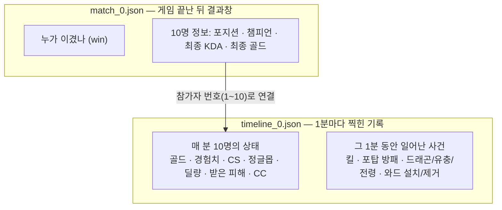
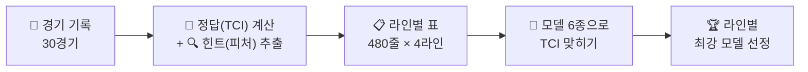
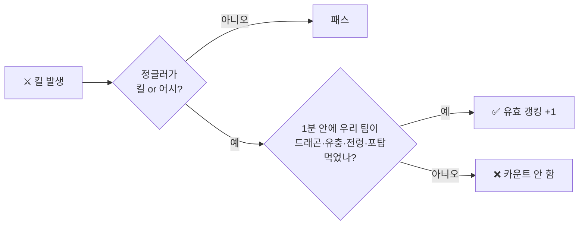
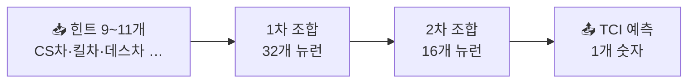
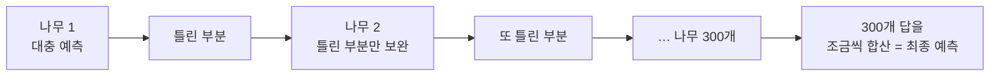

# 🎮 롤 4대 라인별 "진짜 라인전 실력" 측정 모델 (TCI)

> **"이겼다고 잘한 게 아니고, 졌다고 못한 게 아니다."**
>
> 버스 탄 승리, 팀 때문에 진 패배 — 승패만 보면 개인 실력을 알 수 없습니다.
> 2025 시즌 KR 챌린저 솔로랭크 30경기의 **1분 단위 기록**을 뜯어서, 라인별로 **"매 분 내 맞라이너보다 골드를 얼마나 더 먹고 있었나"** 를 숫자(TCI)로 만들고, 그 숫자를 **CS·킬·데스·포탑 방패·와드 같은 플레이 기록만 보고 맞힐 수 있는지** 확인한 프로젝트입니다.

---

## 1. 프로젝트 개요

### 1.1 배경 및 문제 정의 : 승패는 '내 실력'이 아니다
롤 해본 사람이면 다 압니다. 탑에서 솔킬 두 번 따고 CS 40개 앞서도 바텀이 터지면 지고, 미드가 0/5/2로 터져도 정글·원딜이 캐리하면 이깁니다.
그런데 OP.GG 같은 전적 사이트도 결국 **승률, KDA, 게임 끝났을 때 골드** 같은 *결과*만 보여 줍니다.

그래서 이 프로젝트는 **게임이 진행되는 과정**에 주목했습니다.
라이엇 API는 게임 중 **1분마다 10명 전원의 골드·CS·딜량**을 찍어 두고(타임라인), **킬·포탑 방패·드래곤·와드 같은 사건**도 시간과 함께 기록합니다. 이걸로 **"매 분, 내 라인이 이기고 있었나 지고 있었나"** 를 보는 지표를 만들 수 있습니다.

### 1.2 분석 대상 라인 소개 : 라인마다 '잘한다'의 기준이 다르다

| 라인 | 비교 대상 | 이 라인의 핵심 (가설) | 추가로 본 지표 |
|:---:|:---|:---|:---|
| **탑** 🗡️ | 탑 vs 탑 | 갱이 적은 외딴 라인 → **CS 관리, 1:1 솔킬** | 솔킬, 포탑 방패 |
| **미드** 🔮 | 미드 vs 미드 | 맵 한가운데 → **라인전 + 로밍으로 다른 라인 지원** | 솔킬, 포탑 방패, 로밍 킬관여 |
| **정글** 🌲 | 정글 vs 정글 | 라인이 없음 → **갱킹 성공, 캠프 관리, 오브젝트** | 정글몹 처치, 어시, 드래곤·유충, 유효 갱킹 |
| **바텀** 🏹 | (원딜+서폿) vs (원딜+서폿) | 2:2 라인 → **킬각 싸움, 서폿 시야 장악** | 포탑 방패, 어시, 와드 설치·제거 |

> 바텀은 원딜과 서폿을 따로 보지 않고 **한 팀(듀오)** 으로 묶었습니다. 바텀 라인전은 둘이 같이 이기고 같이 지기 때문입니다.

### 1.3 프로젝트 핵심 목표
1. **[정답 만들기]** "이 라인이 지금 이기고 있나?"를 하나의 숫자 **TCI** 로 정의하고, 이 숫자가 실제 승패와도 같은 방향인지 확인한다.
2. **[힌트 만들기]** 라인마다 그 라인에 맞는 플레이 기록(피처)을 뽑는다. 방식은 전부 **"블루 − 레드" 격차**로 통일한다.
3. **[맞히기]** 단순한 계산식부터 인공신경망까지 **6가지 모델**로 TCI를 맞혀 보고, 라인별로 가장 잘 맞히는 모델을 고른다.

---

## 2. 데이터셋 (Dataset)

| 항목 | 상세 내용 |
|:---|:---|
| **수집 대상** | 2025 시즌 **KR 서버 챌린저** 솔로랭크 |
| **경기 수** | **30경기** (게임 시간 20분~41분) |
| **데이터 출처** | Riot API — `match_0.json`(경기 결과) + `timeline_0.json`(1분 단위 기록) |
| **사용 구간** | **5분~20분** (라인전~중반. 모든 경기가 20분 이상이라 빠지는 경기 없음) |
| **학습 데이터** | 라인마다 30경기 × 16분 = **480줄**, 4개 라인 합계 **1,920줄** |
| **검증 방식** | **경기 단위 5등분 교차검증** (아래 3.4 설명) |

**두 파일의 관계** — 같은 경기를 "결과표"와 "1분 단위 리플레이 기록"으로 나눠 준다고 생각하면 됩니다.



---

## 3. 분석 파이프라인 (Methodology)



### 3.1 [STEP 1] 정답(타겟 변수) 정하기 : "지금 누가 이기고 있나?"

모델을 학습시키려면 먼저 **"맞혀야 할 정답"** 이 필요합니다. 후보 지표를 "게임 끝났을 때 이 값이 더 큰 팀이 이겼나?"로 비교했습니다.

#### 📊 [분석 1] 어떤 지표가 승패를 가장 잘 보여 주나

> **인사이트:** 골드가 많은 팀이 **30경기 모두(100%) 이겼습니다.** 경험치·킬도 97%로 강하지만 골드를 넘지는 못합니다. 반대로 '받은 피해량'이 많은 팀은 27%만 이겼습니다(많이 맞는 쪽이 짐).
> → **골드**를 정답으로 결정. 다만 "게임 끝났을 때 골드"는 그냥 결과라서, **매 분의 골드 차이**를 씁니다.

#### 🎯 TCI 공식 (쉽게 풀기)

$$
\text{TCI} = \frac{\text{우리 라인 골드} - \text{상대 라인 골드}}{\text{게임 전체(10명) 골드}}
$$

- **양수(+)면 블루 라인이 이기는 중, 음수(−)면 레드 라인이 이기는 중**입니다. 예를 들어 TCI = +0.03 이면 "게임에 풀린 전체 골드의 3%만큼 블루가 앞서 있다"는 뜻입니다.
- **왜 전체 골드로 나누나?** 10분의 1,000골드 차이와 20분의 1,000골드 차이는 무게가 다릅니다. 10분엔 10명 합쳐 약 3.4만 골드, 20분엔 약 7.5만 골드라서, 같은 1,000골드라도 10분 쪽이 훨씬 큰 차이입니다. 전체로 나누면 **언제든 같은 기준**으로 비교됩니다.

#### 📊 [분석 2] 경험치도 섞으면 더 좋아질까?

> **인사이트:** 골드와 경험치를 여러 비율로 섞어 보며 "TCI 앞선 팀이 실제로 이겼나"를 360번(4라인 × 10·15·20분 × 30경기) 확인했습니다.
> - **골드만 쓰면 65.0%**, 가장 잘 섞었을 때(골드 0.5~0.6) **65.8%** 로, 차이는 **360번 중 3번**뿐입니다.
> - 경험치만 쓰면 61.1%로 오히려 떨어집니다.
> → 경험치를 섞어도 거의 안 좋아지고 설명만 복잡해지므로, **정답은 골드 하나로 깔끔하게** 정했습니다. (경험치도 결국 CS·킬에서 나와서 골드와 거의 같이 움직이기 때문입니다.)

#### 📊 [분석 3] 라인 하나의 TCI만 봐도 승패가 보이나

> **인사이트:** 모든 라인·시간에서 50%(동전 던지기)보다 높습니다. 특히 **15분에 정글 골드가 앞선 팀은 73% 승리**, **20분에 바텀이 앞선 팀도 73% 승리**. 그리고 모든 라인에서 10분보다 15분 이후가 더 잘 맞아서, **"10~15분에 게임이 기운다"** 는 체감이 데이터로도 보입니다.
> *(30경기라 1경기 = 약 3.3%p. 경향을 보는 용도로 해석해야 합니다.)*

#### 📊 [분석 4] TCI로 보는 한 판의 흐름

> **인사이트:** 그레이브즈(블루) vs 리신(레드) 정글 대결. 리신이 3~6분에 골드를 앞서가다가, 그레이브즈가 7~11분에 킬 관여를 쌓아 크게 역전 → 12분 이후 격차가 점점 줄어 23~28분엔 거의 동점 → 29분부터 다시 벌리고 블루 승리. **결과창에는 "블루 승" 한 줄이지만, TCI로 보면 초반에 지다가 뒤집고, 따라잡혔다가 다시 벌린 게임**이었습니다.

#### 📊 [분석 5] 라인별로 격차는 얼마나 벌어지나

> **인사이트:** **바텀 격차가 항상 제일 큽니다.** 2명이 묶여 있어서 킬 한 번에 둘 다 손해를 보기 때문이고, 시간이 갈수록 계속 벌어집니다. 탑은 9분쯤, 미드는 15~17분쯤 격차가 가장 커집니다.

---

### 3.2 [STEP 2] 힌트(피처) 정하기 : "어떤 플레이 기록을 보고 맞힐까"

#### ① 방식은 '격차' 하나로 통일
수업 예제(`data_process_sample.py`)는 힌트를 만드는 방법 4가지를 보여 줍니다.

| 방식 | 뜻 | 예시 | 사용 |
|:---|:---|:---|:---:|
| 누적 | 지금까지 쌓인 내 값 | 내 CS 120개 | |
| **격차** | **내 값 − 상대 값** | **CS 차이 +15개** | ✅ |
| 시점 | 지난 1분 동안 늘어난 양 | 최근 1분 딜량 | |
| 이벤트 | 특정 사건 횟수 | 솔킬 2회 | 격차로 바꿔 사용 |

**격차를 고른 이유**
- **정답(TCI)도 "블루 − 레드" 차이**라서, 힌트도 차이여야 말이 맞습니다.
- **CS 120개가 잘한 건지는 상대를 봐야 압니다.** 상대가 140개면 진 거니까요.
- 해외 승패 예측 연구들도 대부분 **골드 차이, 경험치 차이, 킬 차이** 같은 격차를 핵심 입력으로 씁니다 [1][2][3].
- 솔킬·방패 같은 이벤트도 **"블루 횟수 − 레드 횟수"** 로 바꿔서 전부 같은 방식으로 맞췄습니다.
- 여기에 **"지금 몇 분인지(minute)"** 도 같이 넣었습니다. 같은 CS 10개 차이라도 7분과 18분은 의미가 다르니까요.

#### ② 모든 라인 공통 힌트 6개

| 힌트 | 쉽게 말하면 |
|:---|:---|
| `csDiff` | CS 차이 (미니언 + 정글몹) |
| `dmgDealtDiff` | 챔피언한테 넣은 딜 차이 |
| `dmgTakenDiff` | 맞은 딜 차이 (많이 맞았으면 손해) |
| `ccDiff` | 상대를 CC로 묶은 시간 차이 |
| `killDiff` | 킬 차이 |
| `deathDiff` | 데스 차이 |

#### ③ 라인별 전용 힌트

| 라인 | 전용 힌트 | 쉽게 말하면 | 넣은 이유 |
|:---:|:---|:---|:---|
| 🗡️ 탑 | `soloKillDiff` | 솔킬 차이 | 탑은 1:1 무력 싸움 |
| | `plateDiff` | 탑 포탑 방패 깬 개수 차이 | 14분 전 방패 골드 = 라인 주도권 보상 |
| 🔮 미드 | `soloKillDiff` | 솔킬 차이 | 짧은 라인이라 교전 잦음 |
| | `plateDiff` | 미드 포탑 방패 차이 | 라인 푸시 주도권 |
| | `roamKADiff` | **상대 미드 말고 다른 챔피언** 잡는 데 낀 횟수 차이 | 로밍으로 사이드 도와주는 게 미드 역할 |
| 🌲 정글 | `jgCsDiff` | 정글몹 처치 차이 | 동선·캠프 관리 |
| | `assistDiff` | 어시 차이 | 갱 가서 라이너 킬 만들어 준 것 |
| | `epicDiff` | 팀 드래곤·유충·전령 차이 | 오브젝트는 정글 책임 |
| | `effGankDiff` | **유효 갱킹** 차이 (아래 그림) | 킬로 끝나지 않고 이득을 챙겼나 |
| 🏹 바텀 | `plateDiff` | 바텀 포탑 방패 차이 | 2:2 라인 주도권 |
| | `assistDiff` | 어시 차이 | 서폿의 주 기여 방식 |
| | `wardPlacedDiff` | 와드 박은 개수 차이 | 서폿 시야 장악 |
| | `wardKillDiff` | 와드 지운 개수 차이 | 상대 시야 끊기 |

**🌲 유효 갱킹이란?** — 갱 가서 킬만 따고 끝나면 반쪽짜리. **킬 후 1분 안에 드래곤·유충·포탑을 챙겼으면 "유효 갱킹"** 으로 칩니다.



#### 📊 [분석 6] 힌트들이 TCI와 얼마나 같이 움직이나

> **인사이트:** (1에 가까울수록 "이게 높으면 TCI도 높다", −1에 가까울수록 반대)
> - **모든 라인에서 킬 차이는 강하게 +(0.70~0.86), 데스 차이는 강하게 −(−0.53~−0.76).** 당연하지만 데이터로도 확인.
> - **CS 차이는 탑(0.80)·미드(0.74)에서 강하고 정글(0.40)에선 약합니다.** 정글은 캠프 수보다 싸움 결과가 골드를 좌우한다는 신호.
> - 라인 전용 힌트도 효과 있음: 탑 **포탑 방패 0.63**, 미드 **로밍 0.56**, 정글 **유효 갱킹 0.42**, 바텀 **어시 0.66**.
> - **CC 시간, 와드 제거, 드래곤**은 거의 관계 없음(0.2 미만). CC나 시야는 팀에 도움이 돼도 **내 골드로 바로 바뀌진 않기 때문**입니다.

---

### 3.3 [STEP 3] 모델 학습 : "6가지 방법으로 맞혀 보기"

모델 = **힌트를 보고 정답을 맞히는 계산기**입니다. 간단한 것부터 복잡한 것까지 6개를 붙여 봤습니다.

| 모델 | 롤로 비유하면 | 특징 |
|:---|:---|:---|
| **Baseline(평균)** | 무조건 "비슷하겠지" 찍기 | 비교용 기준선. 이것보다 못하면 의미 없음 |
| **선형회귀** | "CS 1개 = 몇 점, 킬 1개 = 몇 점" 고정 점수표 | 가장 단순, 해석 쉬움 |
| **Ridge** | 점수표인데, 한 항목에 점수가 몰리지 않게 제한 | 비슷한 힌트(킬·CS)가 섞여도 안정적 |
| **RandomForest** | "CS 10개 이상 앞서? → 킬도 앞서? → …" 질문 나무 300개의 다수결 | 조건 분기에 강함 |
| **LightGBM** | 질문 나무를 하나씩 추가하면서 **앞 나무가 틀린 부분만 계속 보완** | 대회에서 많이 쓰는 강력한 모델 |
| **MLP (인공신경망)** | 힌트들을 여러 번 섞어서 **"CS도 앞서고 데스도 적을 때"** 같은 조합을 스스로 학습 | 가장 유연, 대신 데이터가 많이 필요 |

**채점 방식 (손실함수)**
- 모델이 틀린 만큼 **(정답 − 예측)² 의 평균(MSE)** 을 벌점으로 주고, 이 벌점이 작아지도록 학습합니다.
- 결과는 4가지로 봅니다.
  - **RMSE** : 평균적으로 얼마나 빗나갔나 (작을수록 좋음)
  - **R²** : 정답의 움직임을 몇 % 설명했나 (1이면 100%, 0이면 찍기 수준)
  - **부호 일치율** : "블루가 이기는 중 / 지는 중"을 맞힌 비율

### 3.4 공정한 시험 방법 : 경기 단위 교차검증
> **문제:** 같은 경기의 15분과 16분은 거의 똑같습니다. 15분으로 공부하고 16분으로 시험 보면 **기출문제 그대로 나온 시험**이라 점수가 뻥튀기됩니다.
>
> **해결:** 30경기를 6경기씩 **5묶음**으로 나누고, **4묶음(24경기)으로 공부 → 처음 보는 1묶음(6경기)으로 시험**을 5번 돌려 평균을 냈습니다. 즉 모든 점수는 **"한 번도 본 적 없는 경기"** 기준입니다.
>
> 랜덤성이 있는 모델(RandomForest·LightGBM·MLP)은 시작값(시드)을 5번 바꿔 돌린 평균을 썼습니다.

---

## 4. 결과 (Results)

### 4.1 모델 대결 결과


**RMSE (빗나간 정도, ×0.001, 낮을수록 좋음)**

| 모델 | 탑 | 미드 | 정글 | 바텀 |
|:---|:---:|:---:|:---:|:---:|
| Baseline (찍기) | 21.65 | 23.72 | 23.25 | 35.50 |
| 선형회귀 | 9.64 | 10.97 | 13.08 | 16.67 |
| Ridge | 9.41 | 10.77 | 12.50 | 16.50 |
| RandomForest | 10.54 | 11.10 | 11.47 | 17.59 |
| LightGBM | 8.64 | 10.46 | **🏆 10.26** | 15.85 |
| MLP (신경망) | **🏆 7.33** | **🏆 10.16** | 10.39 | **🏆 14.05** |

> **인사이트:**
> - **제일 단순한 선형회귀도 찍기보다 오차가 44~55% 작습니다.** → 힌트(피처)를 잘 골랐다는 뜻.
> - **신경망(MLP)이 탑·미드·바텀 1위**, 정글은 LightGBM이 1위(MLP와 0.13 차이로 거의 동점).
> - **정글은 선형회귀가 특히 약하고(13.08) 나무·신경망 모델이 훨씬 좋습니다(10.26).** 정글 골드는 "킬 몇 개 이상이면 확 벌어진다" 같은 계단식 관계라서, 단순 점수표로는 잘 안 맞습니다.

### 4.2 🏆 라인별 최종 모델 성적

| 라인 | 최종 모델 | R² (설명력) | 우세 팀 맞힌 비율 | 찍기 대비 오차 감소 |
|:---:|:---|:---:|:---:|:---:|
| 🗡️ 탑 | MLP | **0.88** | **93%** | 66% ↓ |
| 🔮 미드 | MLP | 0.81 | 87% | 57% ↓ |
| 🌲 정글 | LightGBM | 0.80 | 86% | 56% ↓ |
| 🏹 바텀 | MLP | 0.84 | 88% | 60% ↓ |


> **인사이트:** 점이 대각선에 붙어 있을수록 잘 맞힌 것. **처음 보는 경기**에서도 4개 라인 모두 대각선 근처에 모여 있습니다. 쉽게 말해, **CS·킬·데스 등 기록만 보고 "지금 이 라인이 몇 골드쯤 이기고 있는지"를 80~88% 수준으로 설명할 수 있다**는 뜻입니다.

### 4.3 라인별로 승부를 가르는 것

> *(이 그래프는 "이 힌트를 가리면 모델이 얼마나 헤매나"를 잰 것. 막대가 길수록 모델이 많이 의존하는 힌트입니다.)*

| 라인 | 1순위 | 2순위 | 한 줄 요약 |
|:---:|:---|:---|:---|
| 🗡️ 탑 | **CS 차이 44%** | 킬 차이 24% | **"탑은 CS가 곧 실력"** — 갱이 적어서 막타 싸움이 1순위. **포탑 방패도 10%** 로 다른 라인보다 확실히 중요 |
| 🔮 미드 | **킬 차이 37%** | CS 차이 32% | **"킬과 CS 반반"** — 짧은 라인이라 교전과 라인 관리가 둘 다 중요 |
| 🌲 정글 | **킬 차이 72%** | CS 차이 8% | **"정글은 캠프보다 싸움"** — 정글 골드는 거의 전부 교전 결과로 결정 |
| 🏹 바텀 | **킬 차이 54%** | 게임 시간 11% | **"바텀은 킬각 싸움"** — 킬 한 번에 2명분 격차, 시간이 갈수록 격차가 커짐 |

> **의외였던 점**
> - **미드 로밍(2%)**: 로밍은 상관은 있었지만 모델은 거의 안 씀. 로밍 가서 사이드를 살려도 **미드 본인 골드는 많이 안 늘기** 때문. (TCI가 "자기 라인 골드"만 보는 한계)
> - **정글 유효 갱킹(0.3%)·드래곤(1%)**: 드래곤 골드는 팀 5명에게 나눠 들어가서 **정글러 개인 격차엔 잘 안 보임**.
> - **바텀 와드(1% 안팎)**: 시야는 엄청 중요하지만 **골드로 바로 바뀌는 플레이는 아님**.

### 4.4 언제 예측이 어려운가

> **인사이트:**
> - **탑**은 가장 안정적입니다. 15분 이후 조금씩 오르지만 내내 제일 낮습니다.
> - **정글은 반대로 초반(5~11분)이 어렵고 12분 이후 좋아집니다.** 초반 정글 골드는 첫 갱 성공/실패 한 번에 크게 흔들리기 때문입니다.
> - **미드는 14분부터 오차가 확 커집니다.** 딱 **포탑 방패가 사라지고 미드가 사이드로 빠지기 시작하는 타이밍**. 라인 기록만으로는 설명이 안 되는 플레이가 많아집니다.
> - **바텀은 10분 이후 꾸준히 어려워집니다.** 바텀 듀오가 흩어져 다른 라인·한타에서 골드를 먹기 시작하기 때문입니다.

---

## 5. 결론 및 주요 인사이트

1. **"라인 골드 우위"는 플레이 기록만으로 80~88% 설명할 수 있다.**
   승패를 보지 않고도 CS·킬·데스·방패·와드 같은 플레이 기록만으로 라인별 골드 우위(TCI)를 R² 0.80~0.88, 우세 판정 86~93% 정확도로 맞혔습니다.

2. **라인마다 '잘한다'의 기준이 다르다.**
   * **탑:** **CS(막타)** 가 1순위, 포탑 방패도 중요. 라인 관리가 기본.
   * **미드:** **킬과 CS가 반반.** 라인 관리와 교전 둘 다.
   * **정글·바텀:** **킬(교전 결과)** 이 압도적 1순위. 싸움에서 이기는 게 핵심.
   → 모든 라인을 KDA 하나로 평가하는 기존 전적 사이트 방식의 한계를 보여 줍니다.

3. **TCI가 못 잡는 기여가 있다.**
   로밍, 시야, 드래곤처럼 **팀에는 도움이 되지만 내 골드는 안 늘어나는 플레이**는 낮게 평가됩니다. 서폿·로밍형 미드를 공정하게 보려면 지표 보완이 필요합니다.

4. **10~15분이 승부처.**
   모든 라인에서 15분 골드 우위가 10분보다 승패를 더 잘 맞히고, 미드·바텀은 14분 이후 예측이 어려워집니다. **라인전 → 운영으로 넘어가는 구간**이 데이터에서도 뚜렷하게 보입니다.

---

## 6. 최종 모델 쉽게 이해하기

### 🧠 MLP (인공신경망) — 탑·미드·바텀 1위



- **어떻게 동작?** 1차 층에서 힌트를 32가지 방식으로 섞고("CS차 많이 + 데스차 조금"), 2차 층에서 그걸 다시 16가지로 섞어 최종 답을 냅니다. 그래서 **"CS도 앞서고 + 데스도 적으면 → 크게 이기는 중"** 같은 **조합 판단**을 할 수 있습니다. 점수표(선형회귀)는 이런 조합을 못 합니다.
- **어떻게 학습?** 틀린 만큼 벌점(MSE)을 받고, 벌점이 줄어드는 방향으로 내부 숫자(가중치)를 조금씩 고칩니다. 이걸 수백 번 반복합니다(역전파).
- **480줄은 신경망한테 적은 데이터라 '암기' 방지 장치를 걸었습니다.**
  - 뉴런 수를 작게 (32 → 16)
  - 가중치가 너무 커지면 벌점 추가 (L2 규제)
  - 시험 점수가 10번 연속 안 오르면 학습 중단 (Early Stopping)

> 💡 **실험 중 겪은 문제:** 처음엔 신경망 점수가 **R²가 마이너스, 즉 찍기보다도 훨씬 못했습니다.** TCI 값이 ±0.03 정도로 너무 작아서 신경망이 신호를 못 잡은 것. **정답 값을 크게 늘려서(표준화) 학습시키고 다시 원래 크기로 되돌리자** 1등이 됐습니다. → 신경망은 입력뿐 아니라 **정답의 크기도 맞춰 줘야 한다**는 걸 배웠습니다.

> ⚠️ **단점:** 시작값(시드)에 따라 결과가 조금씩 흔들립니다. 그래서 5번 돌린 평균으로 보고했습니다.

### 🌳 LightGBM — 정글 1위



- **어떻게 동작?** 첫 나무가 "킬 차이 2 이상이면 이기는 중" 같은 질문으로 대충 맞히고, 다음 나무는 **첫 나무가 틀린 부분만** 집중해서 고칩니다. 이걸 300번 반복합니다. 오답노트를 계속 쓰는 방식.
- **왜 정글에서 강했나?** 정글은 **킬 차이(0, 1, 2…)가 72%** 를 차지하는데, 킬은 딱딱 끊어지는 숫자입니다. "킬 2개 이상 앞서면 확 유리" 같은 **계단식 판단**은 질문 나무가 제일 잘합니다.

---

## 7. 한계 및 향후 과제 (Future Work)

- **데이터 확장:** 현재 30경기라 결과가 흔들릴 수 있습니다. 수백~수천 경기로 늘려 신뢰도를 높일 계획입니다.
- **"당연한 결과" 줄이기:** CS와 킬은 그 자체로 골드를 주기 때문에 중요도가 높은 건 어느 정도 당연합니다. **골드로 바로 안 바뀌는 플레이(시야, 로밍 동선, 위치)** 의 비중을 늘려야 진짜 '실력'에 가까워집니다.
- **팀 기여 반영:** 로밍·시야·드래곤처럼 팀을 돕는 플레이도 점수에 들어가도록 **팀 전체 골드 변화**를 함께 보는 TCI 2.0 설계.
- **20분 이후 모델:** 라인이 무너지는 후반은 한타·바론 중심의 별도 모델이 필요합니다.
- **모델 세부 튜닝:** 이번엔 각 모델의 기본 설정에 가까운 값 하나만 사용했습니다. 설정값을 여러 개 시험해 보면 더 좋아질 여지가 있습니다.

---

## 8. 기술 스택 및 디렉토리 구조 (Tech Stack)

### 🛠 Tools & Libraries
- **Data:** Python, Riot API (Match-V5 / Timeline)
- **Data Processing:** Pandas, NumPy
- **Visualization:** Matplotlib
- **Modeling:** scikit-learn (선형회귀, Ridge, RandomForest, MLP), LightGBM

### 📂 Directory Structure
```text
├── match_0.json                 # 30경기 결과 데이터
├── timeline_0.json              # 30경기 1분 단위 기록
├── puuid_challengers.txt        # 챌린저 유저 목록
├── access_match.py              # 경기 데이터 구조 살펴보기
├── access_timeline.py           # 타임라인 데이터 구조 살펴보기
├── evaluate_y.py                # 정답 후보 비교 (골드·딜량 등 승패 일치율)
├── data_process_sample.py       # 수업 예제: 피처 4가지 방식 (탑)
├── lane_features.py             # ★ 4개 라인 힌트(X) + 정답 TCI(y) 추출
├── train_lane_models.py         # ★ 6개 모델 × 4라인 학습·비교
├── make_figures.py              # ★ README 그래프 생성
├── lane_tci_dataset.csv         # 학습용 표 (4라인 × 480줄)
├── results/
│   ├── model_metrics.csv        # 라인 × 모델 성적표
│   ├── best_models.csv          # 라인별 최종 모델
│   ├── oof_predictions.csv      # 모델이 처음 보는 경기에서 예측한 값
│   └── feature_importance.csv   # 힌트 중요도
├── figures/                     # 그래프 01~10
└── README.md
```

### ▶️ 실행 순서
```bash
pip install pandas numpy lightgbm scikit-learn matplotlib

python lane_features.py       # 1) 힌트 + 정답 표 만들기
python train_lane_models.py   # 2) 모델 6개 학습·비교 (약 30초)
python make_figures.py        # 3) 그래프 10장 만들기
```

---

## 📚 참고문헌
1. A. Wen, *Predicting League of Legends Match Outcomes from Early Game Statistics*, UCLA 프로젝트 보고서, 2025 — 10분 골드 차이가 승패의 가장 강한 예측 변수. https://astro-wen.github.io/UCLA_C111_LoL/report.html
2. A. C. S. Cruz et al., *League of Legends: An Application of Classification Algorithms to Verify the Prediction Importance of Main In-Game Variables*, SBGames 2021. https://www.sbgames.org/proceedings2021/ComputacaoShort/217082.pdf
3. T. Carroll, *Predicting the Winner of League of Legends Games*, Analytics Vidhya, 2020 — 팀 골드 차이가 가장 큰 결정 요인. https://medium.com/analytics-vidhya/predicting-the-winner-of-league-of-legends-games-c6fb3513b3d4
4. Riot Games, *Riot Developer Portal — MATCH-V5 API*. https://developer.riotgames.com/apis#match-v5
